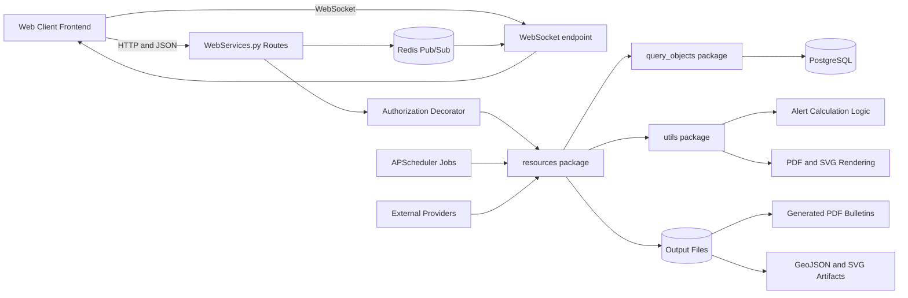
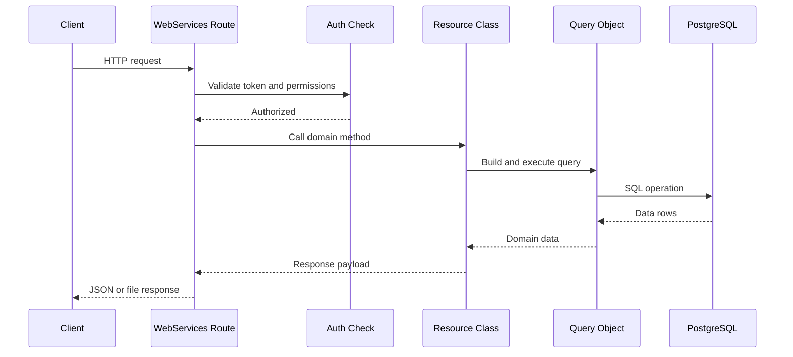
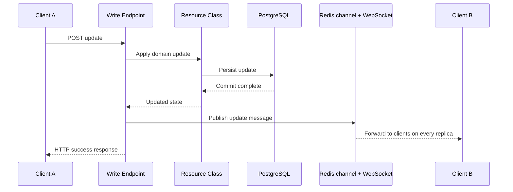
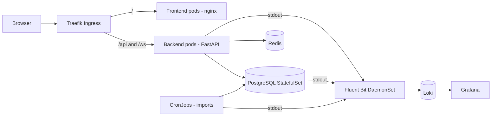
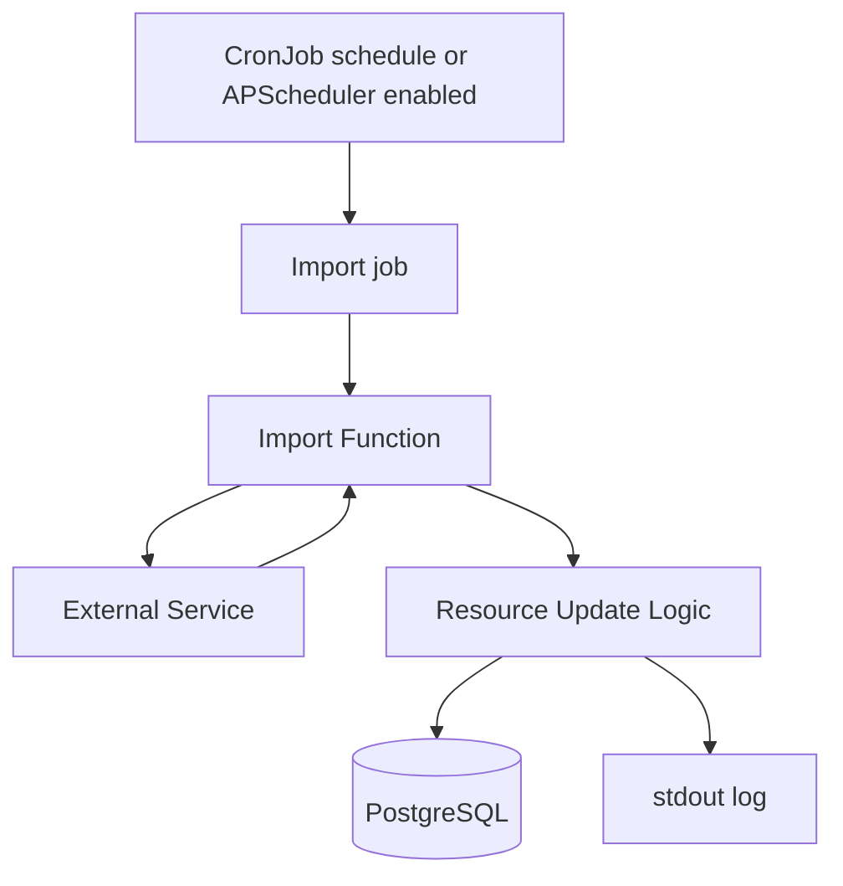
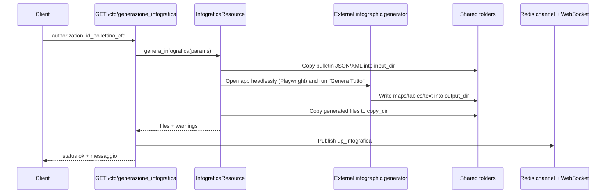
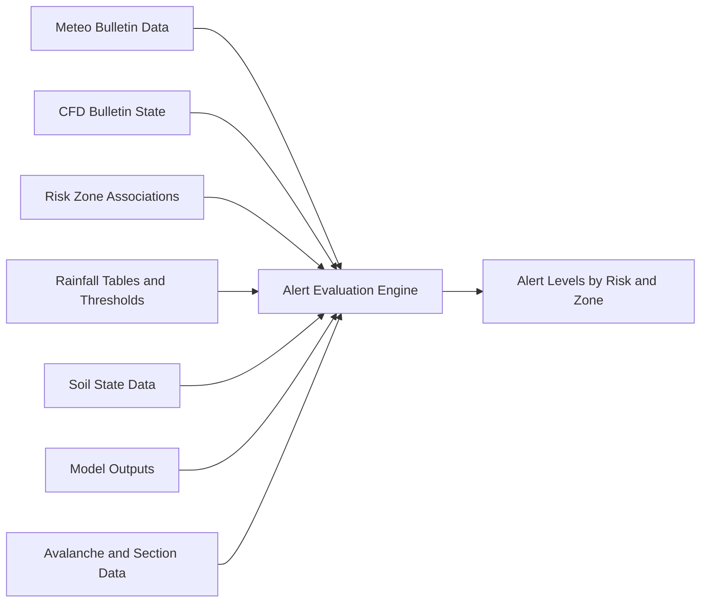

# Diagrams

This page provides quick visual maps of the backend architecture and the most important operational flows.

## System Architecture

## Request Processing Flow

## Write And Realtime Synchronization Flow

## Deployment And Logging Flow

## Scheduled Import Flow

## Infographic Generation Flow

## Alert Level Calculation Inputs

## How To Use These Diagrams

- Use the system architecture diagram for repository landing pages and presentations.
- Use the request and write-flow diagrams when explaining backend behavior to frontend developers.
- Use the scheduled import and calculation diagrams when onboarding operations and forecasting teams.